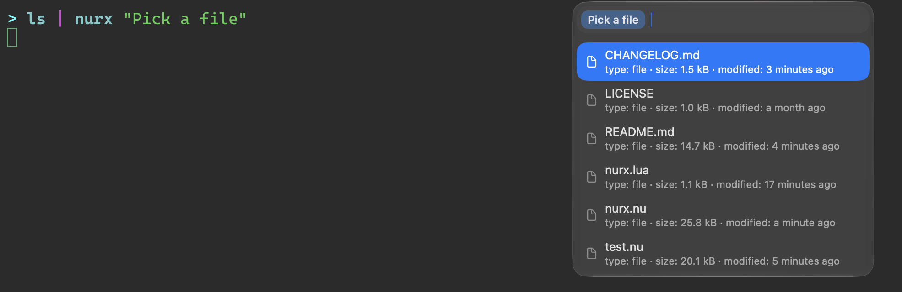
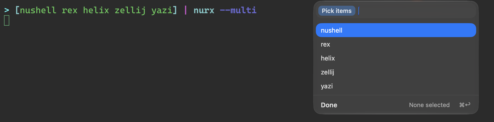

# nu-rex-integration

Nushell commands and hooks for [Rex](https://www.superlogical.com/rex/docs), the terminal multiplexer. Rex keeps its sessions, tabs and panes behind a JSON API, which suits a shell that works on tables. With this module you can filter Rex's panes and events like any other table, pick from any nushell value in Rex's command palette, and run a closure on another Rex host. It also has four hooks, each off until you turn it on:

- `status` reports each command's state to Rex, so a tab in the background shows a spinner while its command runs.
- `last` keeps the last value nu displayed, and `nurx last` opens it in `explore` in a floating pane.
- `layout` opens a project's tabs from `.nurx/layout.nuon` when you `cd` into the project.
- `tint` turns the pane's background dark red in a `prod` folder.

It's one nushell file and a short Lua file for the picker, with no other dependencies. I've tested it with nushell 0.117.1 and Rex 0.1.0-preview.21, on macOS only.

## Install

Clone this repository. The examples here assume you cloned it to `~/src/nu-rex-integration`. Add two lines to the end of `config.nu`:

```nushell
use ~/src/nu-rex-integration/nurx.nu *
nurx enable status last layout tint
```

Name only the features you want in `nurx enable`. Without it, you get the commands and no hooks.

Every command is `nurx` or starts with `nurx`, so none of them hides a subcommand of the `rex` binary. Import with `*`. A plain `use nurx.nu` names them `nurx nurx panes` and so on.

The picker also needs one line in Rex's `init.lua`, usually `~/.config/rex/init.lua`. Run `rex config reload` after adding it:

```lua
dofile(os.getenv("HOME") .. "/src/nu-rex-integration/nurx.lua")
```

## Commands

The flags are ordinary nushell flags, so `--session work` and `-s work` do the same thing. `help nurx panes` shows a command's flags, and so does `nurx panes --help`.

| Command             | What it does                                                                                                                                                                                                                                                                                                    |
| ------------------- | --------------------------------------------------------------------------------------------------------------------------------------------------------------------------------------------------------------------------------------------------------------------------------------------------------------- |
| `nurx`              | Shows the value piped into it in Rex's command palette and returns what you pick. An optional argument sets the question at the top. `--multi` (`-m`) returns a list, `--index` (`-i`) returns positions instead of items, and `--display` (`-d`) takes a column or a closure for each item's title.            |
| `nurx panes`        | Lists every terminal pane with its session, tab, label, focus and IDs. `--session` (`-s`) takes a session label or ID. `--details` (`-d`) adds the foreground program, the folder and the status records.                                                                                                       |
| `nurx status`       | Lists every status record in every pane, newest first. `--session` (`-s`) keeps one session.                                                                                                                                                                                                                    |
| `nurx status send`  | Reports a state for this pane: `idle`, `working`, `done`, `blocked`, `error`, or `clear` to remove it. `--msg` and `--title` take text, `--progress` takes 0 to 100, `--kind` takes `permission`, `question` or `auth` for `blocked`, `--id` takes a record path such as `job/3`, and `--app` defaults to `nu`. |
| `nurx events`       | Streams the server's events as records until you press Ctrl-C. `--session` (`-s`) adds that session's pane events, `--all` (`-a`) gives every event, and `--clients` keeps the client connect and disconnect events.                                                                                            |
| `nurx on`           | Runs a closure in nu on a list of Rex hosts and returns one row per host. `--with` passes a value to the closure as its argument.                                                                                                                                                                               |
| `nurx last`         | Opens this pane's last displayed value in `explore`. `--full` (`-f`) covers the whole tab.                                                                                                                                                                                                                      |
| `nurx layout allow` | Trusts the layout file in a folder, the current one if you don't name one.                                                                                                                                                                                                                                      |
| `nurx layout open`  | Opens a folder's layout as a tab now, trusted or not.                                                                                                                                                                                                                                                           |
| `nurx enable`       | Turns on the hooks for the features you name: `status`, `last`, `layout` or `tint`.                                                                                                                                                                                                                             |
| `nurx version`      | Returns the versions of nurx, nushell and the Rex server.                                                                                                                                                                                                                                                       |

```nushell
# Pick from a value in Rex's command palette
ls | nurx
ls | nurx "Pick a file"
[nushell rex helix] | nurx --multi
[low medium high] | nurx --index
ps | nurx --display name | get pid

# Rex state as tables
nurx panes
nurx panes --session work --details
nurx status --session work
nurx events --session work
nurx events --all --clients

# Report a state for this pane
nurx status send working --msg "uploading" --progress 40
nurx status send working --id job/3 --msg "building"
nurx status send blocked --kind question --msg "approve the deploy?"
nurx status send done --msg "deploy finished"
nurx status send clear

# Run a closure on other Rex hosts
nurx on [local] {|| sys host | get hostname }
nurx on [build windows] {|a| ls $a.dir | length } --with {dir: src}

# The last value, layouts, hooks and the version
nurx last --full
nurx layout allow ~/src/api
nurx layout open ~/src/api
nurx enable status tint
nurx version
```

To read a pane's screen, use Rex's own `rex capture`. For a pane in another session it needs both IDs, `-s` and `-b`, and `nurx panes` lists them.

## Rex state as tables

```nushell
nurx panes --details | where process == cargo
nurx status | where state == error
nurx events -s build | where type == terminal.pwd_changed | first

let logs = (nurx panes | where pane == logs | first)
rex capture -s $logs.session_id -b $logs.block_id --unwrap | lines | last 5
```

`nurx panes` asks the server for each session's view and keeps the terminal panes. With seven panes it took 76 ms. `--details` makes three API calls per pane in parallel and took 176 ms.

`nurx events` names each event the way Rex's Lua `rex.on` does, such as `terminal.pwd_changed` or `window_created`. Each record has `type`, `session_id`, `block_id` and `data`.

Pane events such as `terminal.pwd_changed` come only with `-s SESSION` or `--all`. Without either, you get session-level changes, such as a session starting or ending. Every `rex` call connects to the server as a client, the module's own calls included, so `nurx events` drops `client_connected` and `client_disconnected` unless you pass `--clients`.

## Pick from any value

```nushell
ls | nurx
ls | nurx --multi "Files to stage" | get name
^git branch | nurx | str trim -c '*' | str trim
$env | nurx --multi
```





`nurx` shows what you pipe into it in Rex's command palette, through [`rex.ui.pick`](https://www.superlogical.com/rex/docs/customize/custom-ui), and returns what you picked:

- A table shows one item per row. The first text column is the title and the other columns go underneath, so `ls` shows the name, then the type, size and age. `ls` rows also get a folder or document icon.
- A list shows its items and text shows its lines. You get back the item or the line.
- A record shows its fields, and you get back a record with the fields you picked.

The flags work like those of `input list`. Escape in the palette, or Ctrl-C in the shell, closes it and returns nothing.

Every Rex app connected to the server shows the question, including on your other devices, and the first answer wins. The palette lists at most 2,000 items. A longer input stops with an error before anything shows up, so narrow it with `where` or `first`.

The Lua file exists because Rex only asks the apps from an action the server runs. A script run by `rex do` can't ask, so the question goes through the `nurx_pick` action in `nurx.lua`. Without the `dofile` line in `init.lua`, `nurx` stops and prints the line to add. The action also appears in the command palette, and running it from there fails with "title is required". The server needs `rex.ui`, which Rex 0.1.0-preview.21 has and preview.20 doesn't.

## Run a closure on other hosts

```nushell
nurx on [build-box mac-mini] {|| sys host | get hostname }
nurx on [local] {|a| 1..$a.n | each {|i| $i * 2 } } --with {n: 3}
```

`nurx on` returns one row per host with `host`, `exit_code`, `result` and `error`. Host names come from `rex hosts`, and `local` means the server you're connected to. For each host, in parallel, it opens a hidden session, runs `nu -n -c` with the closure's source, reads the result off the pane's screen as nuon, and kills the session. Passing the result through screen text is a bit of a hack, but it needs nothing on the host except nu.

Some limits:

- Only the closure's source travels. Variables it captured don't exist on the other host, so pass data with `--with`, which becomes the closure's argument.
- The host needs `nu` on its login shell's PATH.
- Rex's screen read stops at 960 KiB, so a large result fails. Have the closure write a file instead.
- It has run against the local server, both as `local` and through `-S` with the server's address, but not against a second machine yet.

## Hooks

`nurx enable` keeps the hooks you already have. It appends to `pre_execution`, `pre_prompt` and `env_change.PWD`, and tags each hook it adds with `nurx: <feature>`. Running it again replaces its own hooks instead of adding copies, so sourcing `config.nu` twice is safe.

`display_output` holds one hook, not a list, so `last` wraps the one you have. A closure stays a closure, a string stays a string, and no hook at all becomes `table`.

Call `nurx enable` at the end of `config.nu`. A later `$env.config.hooks.pre_prompt = [...]` replaces the whole list, including the hooks `nurx enable` added.

### status

Each command reports its state to Rex with OSC 7501, the [program status protocol](https://www.superlogical.com/rex/docs/build/program-status). These are the records Rex holds:

| You run                                    | Rex records                              |
| ------------------------------------------ | ---------------------------------------- |
| `sleep 4sec`, while it runs                | `working`, `sleep 4sec`                  |
| `sleep 4sec`, after it ends                | `done`, `sleep 4sec · exit 0 · 4.01 sec` |
| a command that succeeds in under 3 seconds | none, the hook clears it                 |
| `^false`                                   | `error`, `^false · exit 1 · 0.01 sec`    |
| an external command stopped with Ctrl-C    | `idle`, with exit -2                     |

In Rex 0.1.0-preview.20, a tab you aren't looking at shows a spinner while its command is `working`, and the spinner goes away when the command ends. A `done` record doesn't mark the tab. Rex's docs say the session picker marks sessions with finished or blocked work. `nurx status` lists the records whatever Rex draws.

A quick success clears the record. Otherwise every `ls` would leave a done record behind. `$env.NURX_STATUS_DONE_AFTER` sets the cutoff, 3sec by default.

The report carries your command line, and Rex shows it in its interface. A token you type on the command line shows up there too.

Rex drops a whole report when its message holds a newline or another control character, so the hook flattens a multi-line command onto one line. It also cuts messages at 200 characters.

An internal command stopped with Ctrl-C exits with 1, the same as a real failure, so it reports `error`. A hook can't tell the two apart.

Scripts can send their own reports:

```nushell
nurx status send done --msg "deploy finished"
nurx status send error --msg $"tests failed: ($failures | length)"
```

### last

```nushell
ls | sort-by size --reverse
nurx last
```

`nurx last` opens the value in `explore` in a floating pane that covers 90% of the tab, or all of it with `--full`. `q` closes it, and the scrollback underneath doesn't move.

The `display_output` hook saves every value nu displays to `$nu.cache-dir/nurx/last/<pane>.nuon`, one file per pane, and passes it on unchanged. External commands write straight to the terminal and never reach the hook, so `^echo` leaves the previous value in place. So do values `to nuon` can't write, such as closures.

A string hook can't call the module's private commands. So `nurx enable last` puts the save step in `$env.NURX_LAST_STASH` as a closure, and the wrapped string calls it, which works however you imported the module. Setting the variable yourself does nothing, because `nurx enable last` replaces it.

Two things to know before turning it on:

- It writes every displayed value to disk, secrets included. `open .env` or a printed token ends up in the cache folder.
- It saves the whole value after every display, so `open huge.csv` writes the whole table again. Nothing deletes the files of closed panes.

### layout

A project can ship `.nurx/layout.nuon`:

```nushellon
{
    label: "api"
    layout: {right: ["hx .", {below: ["cargo watch -x check", {label: "shell"}]}], ratio: 0.6}
}
```

When nu enters the folder, the hook opens a tab with that layout in the background of the current session. If a tab with the layout's label is already open, it opens nothing.

A pane is a string, a command that Rex types into a fresh nu, or a record `{run?, label?, cwd?}`. A split is `{right: [a b]}` for side by side or `{below: [a b]}` for stacked, with an optional `ratio` for the first side. `cwd` is relative to the project folder.

A layout runs commands, so the hook only opens trusted ones. Until you trust a layout, entering the folder prints a hint. Run `nurx layout allow` in the folder to trust it. That stores the file's path and SHA-256 in `$nu.data-dir/nurx/layouts-allowed.nuon`. Any edit to the file makes it untrusted again, the same as `direnv allow`. `nurx layout open` skips the trust check, because you're asking for the tab by hand.

Each pane starts `$env.NURX_LAYOUT_COMMAND`, which is `[$nu.current-exe]` by default. Rex can't set environment variables for a pane, so this is how you change what the panes run:

```nushell
$env.NURX_LAYOUT_COMMAND = [$nu.current-exe --login]
$env.NURX_LAYOUT_COMMAND = [$nu.current-exe --no-history -e "print 'started by NURX_LAYOUT_COMMAND'"]
```

The hook runs when PWD differs from what it was at the last prompt, so `cd ..; cd api` on one line doesn't open anything.

### tint

The default rules turn the background dark red in a folder named `prod` or under an `AWS_PROFILE` containing `prod`, and amber when nu runs as admin. Set your own rules in `config.nu`. The first match wins:

```nushell
$env.NURX_TINT_RULES = [
    {when: {|| $env.PWD =~ '/prod(/|$)' }, bg: "#3a0000"}
    {when: {|| ($env.KUBECONFIG? | default "") =~ 'prod' }, bg: "#3a0000"}
]
```

Before each prompt, the hook sends `OSC 11` with the matching color, or `OSC 111` to reset it. It keeps no state, so returning from an ssh session that tinted the pane resets it at the next prompt. It also overrides a background another program set with OSC 11.

It uses OSC 11 instead of Rex's `set_theme` method, because `set_theme` doesn't take effect on a pane the Rex app is showing. OSC 11 is plain output, so a nu on a remote host with this hook should tint your local pane too. Nobody has tried that yet.

Nushell has no exit hook, so leaving a tinted nu with `exit` keeps the tint. The parent shell resets it at its next prompt if it runs this hook too.

## Versions

`nurx version` returns the versions of nurx, nushell and the Rex server. Include it in bug reports.

The version lives in `VERSION` at the top of `nurx.nu`, and [CHANGELOG.md](CHANGELOG.md) has a section for each version, newest first. The newest section always matches `VERSION`, and `nu test.nu` checks that. A section reads "Unreleased" until you tag its version.

To release a version:

1. Replace "Unreleased" in the newest section with the date, such as `## 0.1.0 - 2026-11-18`.
2. Commit, then tag the commit: `git tag v0.1.0`.

To start the next version, set `VERSION` to it and add a new `## X.Y.Z - Unreleased` section at the top of the changelog. Versions follow [semantic versioning](https://semver.org). Renaming or removing a command, flag, environment variable or file location bumps the major version, or the minor version while nurx is at 0.x.

## License

MIT. See [LICENSE](LICENSE).
